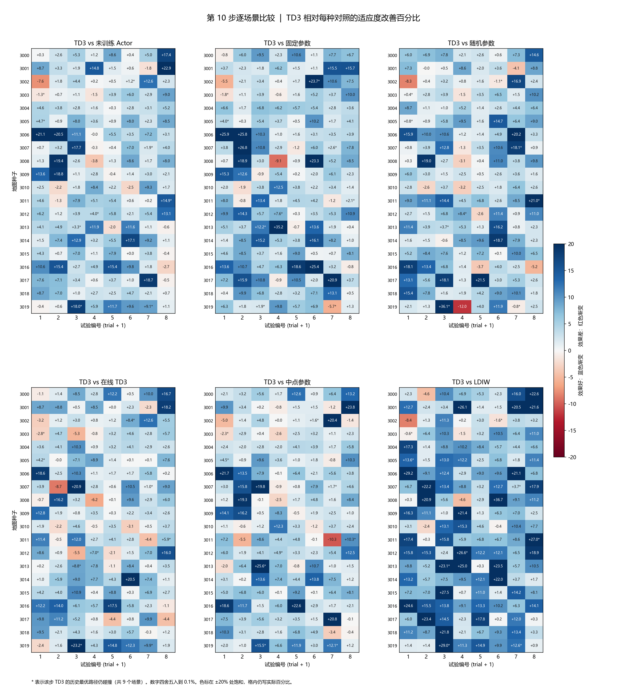
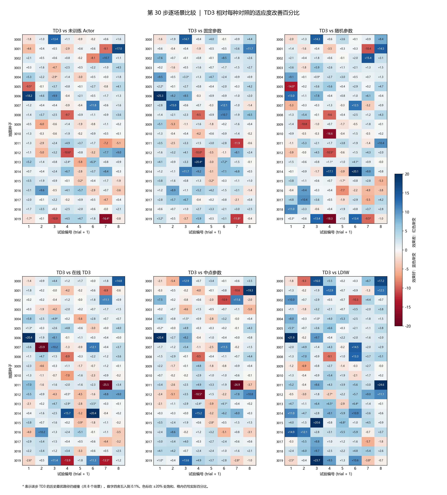
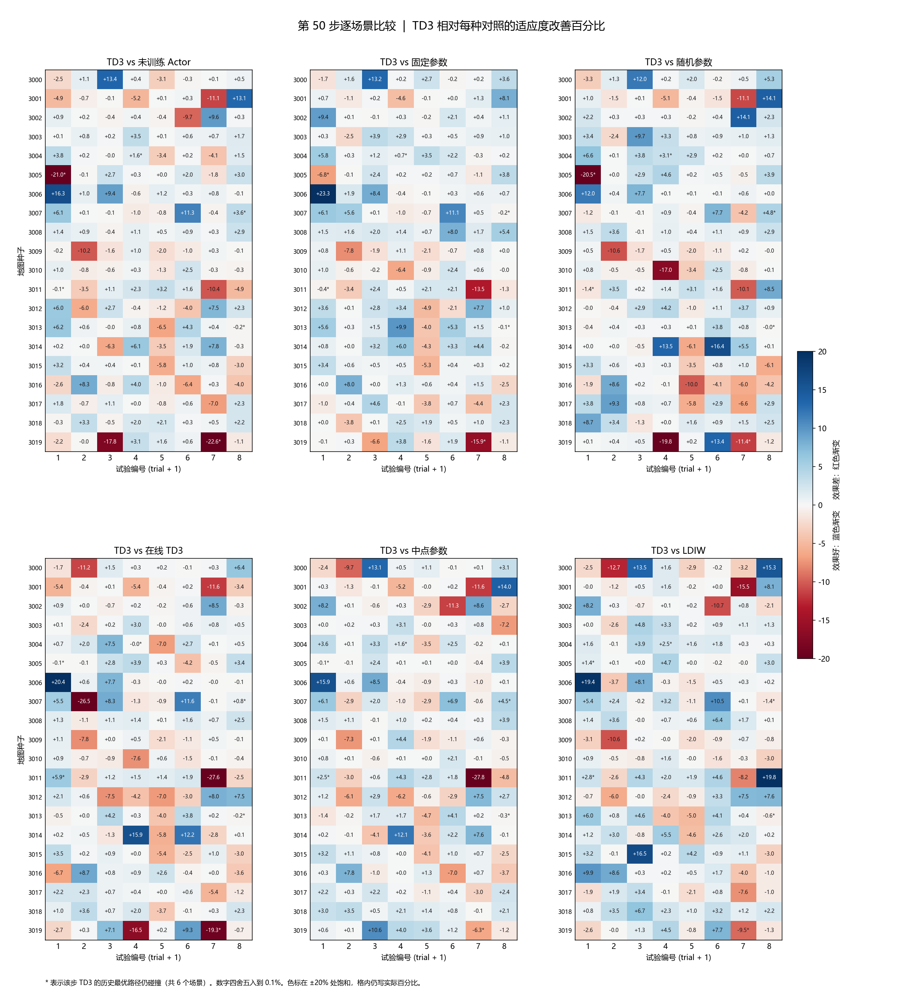
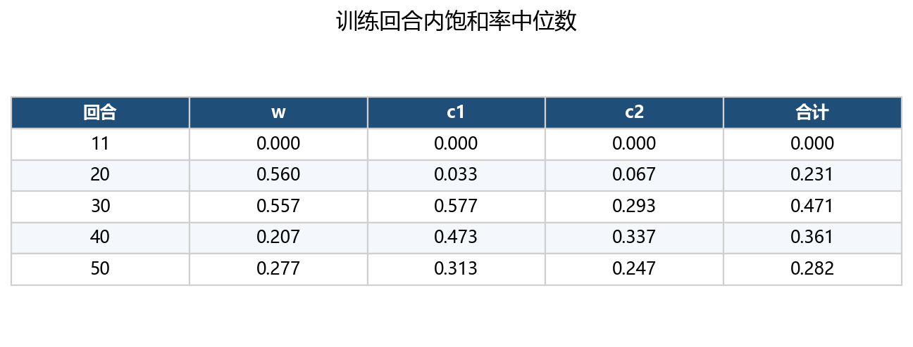
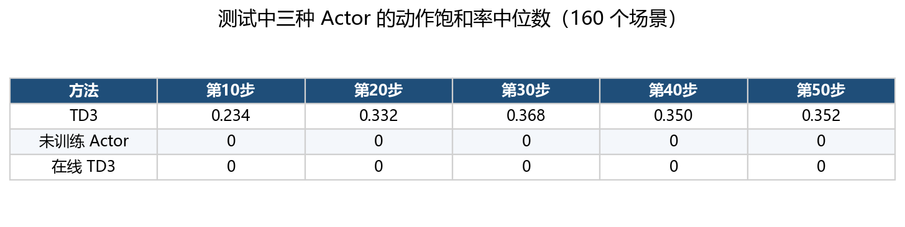

# TD3-PSO

TD3-PSO learns a shared actor that sets the PSO coefficients `(w, c1, c2)` for every particle from that particle's own state. The same swarm update is used at every step. The learned policy changes how strongly each particle trusts its previous velocity, its personal best, and the swarm best.

The reported run trains for 50 episodes of 100 PSO steps on maps in `[0, 20]²`, with 150 particles and 10 path points. The first 1,000 steps only fill the replay buffer. From episode 11 onward, every step stores the transition and applies TD3 updates. Start and goal are drawn from four geometries: the two diagonals and the horizontal and vertical midlines. Midline endpoints are inset to 1.2 so they stay outside the boundary obstacles of radius 0.85.

The held-out test uses the episode-40 checkpoint on map seeds 3000–3019, with 8 populations per map (160 scenarios). Each cell below compares TD3 with one baseline on the same map, the same initial population, and the same PSO random stream.

## Fitness

A candidate path is scored by length, turning, boundary violation, and the deepest obstacle penetration. Lower is better.

```
f = 0.5 * L + 0.2 * (sum of turning angles + maximum turning angle)
    + 100 * sum of squared out-of-bound distances
    + 40 * H
```

`L` is the total polyline length. Turning angles are in radians. `H` is the largest penetration of any path segment into any circular obstacle. A segment that merely touches an obstacle is still a collision. During a normal PSO step, positions are clipped to the map, so the boundary term is zero and the cost is carried by length, turning, and penetration.

## Reward

The actor is trained on the one-step change of each particle. The five terms are

```
r = 5 * max(log(pbest_old / pbest_new), 0)
    + log(f_old / f_new)
    + 5 * max(log(gbest_old / f_new), 0)
    + 2 * (H_old - H_new) / H_ref
    + 1[first feasible path]
```

Personal-best and global-best improvements contribute only when the fitness falls. The adjacent fitness term keeps its sign, so a worse candidate is penalized. Collision depth is rewarded when the worst penetration becomes shallower. The first time a particle becomes collision-free adds a bonus of 1. The return is the discounted sum of these rewards with `γ = 0.97`. There is no terminal state: a 50-step or 100-step rollout is a truncation, and the last step still bootstraps.

## State

The actor and both critics see an 11-dimensional state. Fitness terms are log-normalized by the straight-line length scale `F0 = 0.5 * ||goal - start||` and by a fixed geometric upper bound, then mapped to `[-1, 1]`.

| # | Name | Meaning |
|---|---|---|
| 1 | `gap_pbest` | Current fitness minus personal-best fitness |
| 2 | `gap_gbest` | Current fitness minus global-best fitness |
| 3 | `fitness` | Current path fitness |
| 4 | `velocity_pbest_cos` | Cosine between velocity and the direction to the personal best |
| 5 | `velocity_gbest_cos` | Cosine between velocity and the direction to the global best |
| 6 | `velocity_turn_cos` | Cosine between the current and previous velocity |
| 7 | `penetration` | Worst penetration, scaled by the largest obstacle radius |
| 8 | `collide` | Collision flag, encoded as `-1` or `+1` |
| 9 | `speed_rms` | RMS speed of the movable points, scaled by `v_max = 2` |
| 10 | `distance_pbest` | RMS distance to the personal best |
| 11 | `distance_gbest` | RMS distance to the global best |

Cosines and distances use the movable interior points. The actor output is in `[-1, 1]³` and is mapped linearly to `w ∈ [0.4, 0.9]` and `c1, c2 ∈ [1, 2]`.

## Comparison results

Positive cells mean TD3 has a lower fitness than the baseline on that scenario:

```
100 * (f_baseline - f_TD3) / f_baseline
```

Blue deepens as TD3 improves more. Red deepens as TD3 is worse. The color scale saturates at ±20%, while the printed number is the actual percentage rounded to 0.1%. A star marks a scenario whose TD3 best path at that step is still in collision. The percentage itself does not add an extra collision penalty.

The early budget is where the learned policy is strongest. At step 10, TD3 is better in the large majority of the 160 scenarios against every baseline:

| Baseline | TD3 better | TD3 worse |
|---|---:|---:|
| Untrained actor | 142 | 16 |
| Online TD3 | 136 | 22 |
| Fixed `(0.7, 1.5, 1.5)` | 146 | 14 |
| Midpoint `(0.65, 1.5, 1.5)` | 138 | 21 |
| LDIW, `w` from 0.9 to 0.4 | 152 | 8 |
| Shared random parameters | 145 | 14 |



By step 30 the other methods have continued to descend, so the margin is smaller, and TD3 is still ahead on most maps:

| Baseline | TD3 better | TD3 worse |
|---|---:|---:|
| Untrained actor | 114 | 44 |
| Online TD3 | 111 | 44 |
| Fixed `(0.7, 1.5, 1.5)` | 129 | 31 |
| Midpoint `(0.65, 1.5, 1.5)` | 115 | 41 |
| LDIW | 132 | 27 |
| Shared random parameters | 118 | 40 |



At step 50 the long horizon has let fixed-gain and random-gain PSO keep improving, so the visual gap narrows. TD3 nevertheless remains better in a majority of scenarios against every baseline, including 106 to 47 against fixed parameters and 104 to 47 against shared random parameters.

| Baseline | TD3 better | TD3 worse |
|---|---:|---:|
| Untrained actor | 91 | 63 |
| Online TD3 | 88 | 62 |
| Fixed `(0.7, 1.5, 1.5)` | 106 | 47 |
| Midpoint `(0.65, 1.5, 1.5)` | 96 | 57 |
| LDIW | 95 | 54 |
| Shared random parameters | 104 | 47 |



The counts above are also saved as [td3_scenario_counts.png](results/test_endpoints_20x8_ep40/td3_scenario_counts.png). A tie is a relative gap inside ±0.05%.

## Action saturation

Saturation is measured on the actor output before exploration noise. A component counts as saturated when its absolute value is at least 0.98, which places `w` near 0.4 or 0.9 and `c1` or `c2` near 1 or 2. Each PSO step has 150 particles and 3 outputs, so the step rate is the saturated count divided by 450. The three parameter rates use the same denominator restricted to that parameter, and the total rate is their arithmetic mean.

During training, the reported value for an episode is the median of its 100 step rates. The first 10 episodes only collect data, and all three rates stay at 0. Once gradient updates start, `w` reaches the boundary first. `c1` and `c2` become saturated later, around episode 30, and then ease off.

| Episode | `w` | `c1` | `c2` | Total |
|---|---:|---:|---:|---:|
| 11 | 0.000 | 0.000 | 0.000 | 0.000 |
| 20 | 0.560 | 0.033 | 0.067 | 0.231 |
| 30 | 0.557 | 0.577 | 0.293 | 0.471 |
| 40 | 0.207 | 0.473 | 0.337 | 0.361 |
| 50 | 0.277 | 0.313 | 0.247 | 0.282 |



On the episode-40 checkpoint used for testing, frozen TD3 saturates on roughly a quarter of the components at step 10 and about a third at step 50. The untrained actor and the online TD3 baseline, which starts from the initial weights and learns inside that one scenario, remain at 0 through step 50.

| Method | Step 10 | Step 20 | Step 30 | Step 40 | Step 50 |
|---|---:|---:|---:|---:|---:|
| TD3 | 0.234 | 0.332 | 0.368 | 0.350 | 0.352 |
| Untrained actor | 0 | 0 | 0 | 0 | 0 |
| Online TD3 | 0 | 0 | 0 | 0 | 0 |



This is the mechanism behind the faster early descent. Gradient updates train one shared actor to read a particle's state and, for some of those states, emit a coefficient at the legal extreme. A large `c1` or `c2`, or a small `w`, is the strongest pull or the strongest damping the swarm is allowed to use, so the population moves toward a good path in fewer steps. Saturation is not a permanent lock on a particle: the next state can return that output to the interior. At step 10 only about 23% of components are saturated, so most outputs still depend on the state. The Gaussian exploration noise used in training further keeps executed actions from sticking to the boundary, which is why the saturation rate rises through the middle of training and then falls by episode 50. Online TD3 never reaches that regime inside 50 steps, which is consistent with its smaller early gain. Over a long horizon the extreme updates are less helpful for fine refinement, other methods catch up, and the remaining advantage is a majority of scenarios rather than a large fitness gap.
